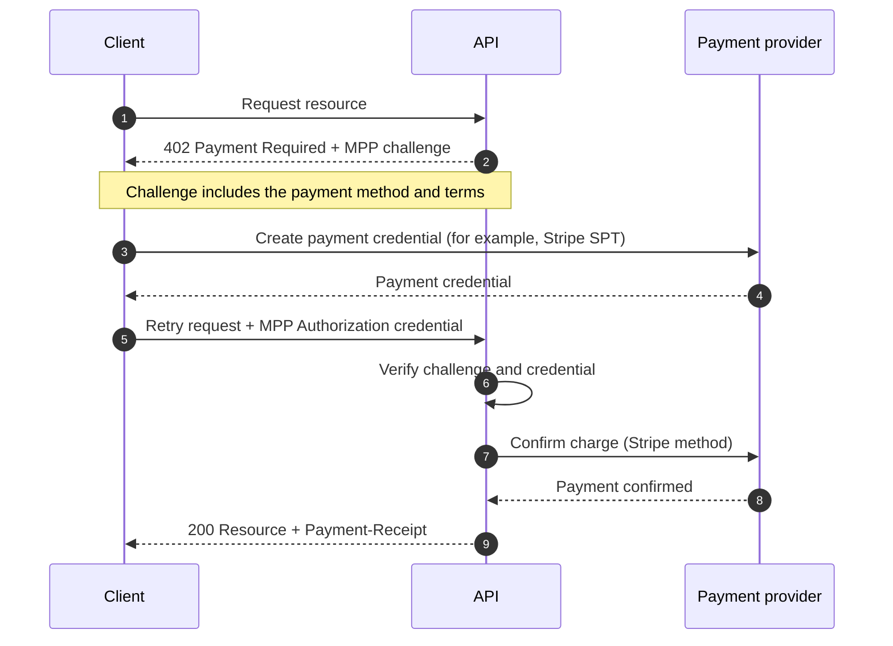
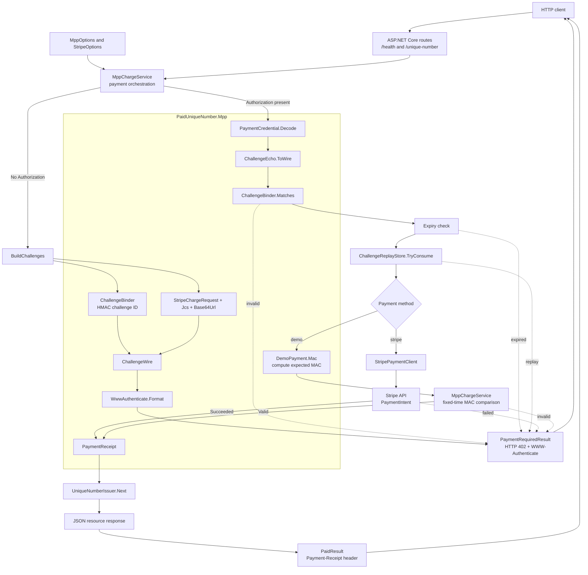
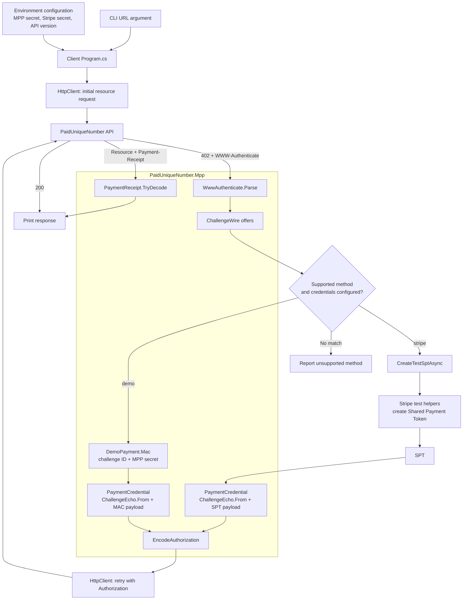

# Pay-per-use unique-number API (using MPP)

ASP.NET Core API that returns a unique number after a **$0.50** Machine Payments Protocol (MPP) charge, plus a C# client that pays and retries.

There is no official C# MPP SDK, so this implements the HTTP `402` Challenge → Credential → Receipt flow from [mpp.dev](https://mpp.dev/protocol). Card charges use Stripe Shared Payment Tokens (minimum $0.50). A local `demo` method is on by default so you can run without Stripe keys.

## How a paid API call works



## System design

### Server



### Client



## Run locally (demo payment)

Terminal 1:

```bash
dotnet run --project src/PaidUniqueNumber.Api
```

Terminal 2:

```bash
dotnet run --project src/PaidUniqueNumber.Client
```

The client requests `GET /unique-number`, receives `402 Payment Required`, attaches a demo Credential, and prints the unique number plus a `Payment-Receipt`.

## Stripe SPT ($0.50 USD)

1. Create a Stripe sandbox API key and [business profile](https://docs.stripe.com/payments/machine/mpp).
2. Set the same values on the API and the client:

```bash
export API_STRIPE_SECRET_KEY=sk_test_...
export API_STRIPE_PROFILE_ID=profile_test_...
export CLIENT_STRIPE_SECRET_KEY=sk_test_...
export API_MPP_SECRET_KEY='a long random secret'
export CLIENT_MPP_SECRET_KEY='a long random secret'
```

3. Restart the API. It now advertises `method="stripe"` for 50 USD cents.
4. Run the client with `CLIENT_STRIPE_SECRET_KEY` set. It creates a test Shared Payment Token (`pm_card_visa`) and retries with that Credential. The API confirms a Stripe PaymentIntent using `API_STRIPE_SECRET_KEY` and then returns the number.
5. For the demo method, keep the same secret on both sides or set `CLIENT_MPP_SECRET_KEY` to match `API_MPP_SECRET_KEY` so the MAC challenge verifies correctly.

Keep `Mpp:AllowDemo` true in `appsettings.json` only for local development.
